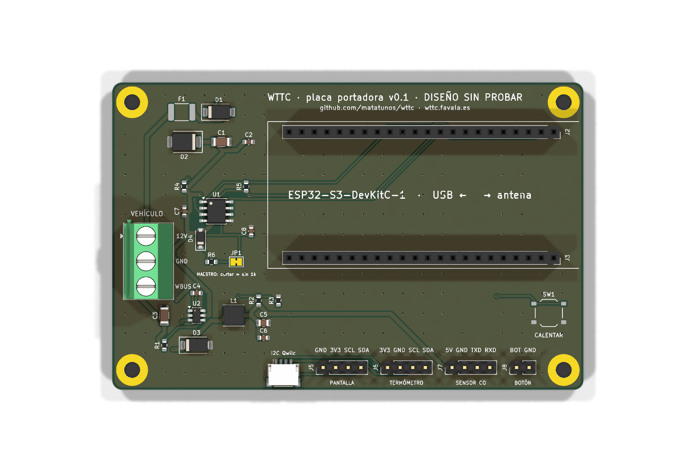
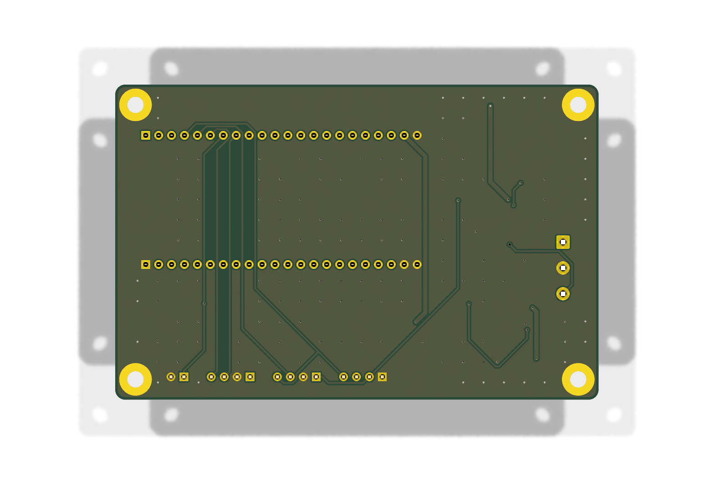
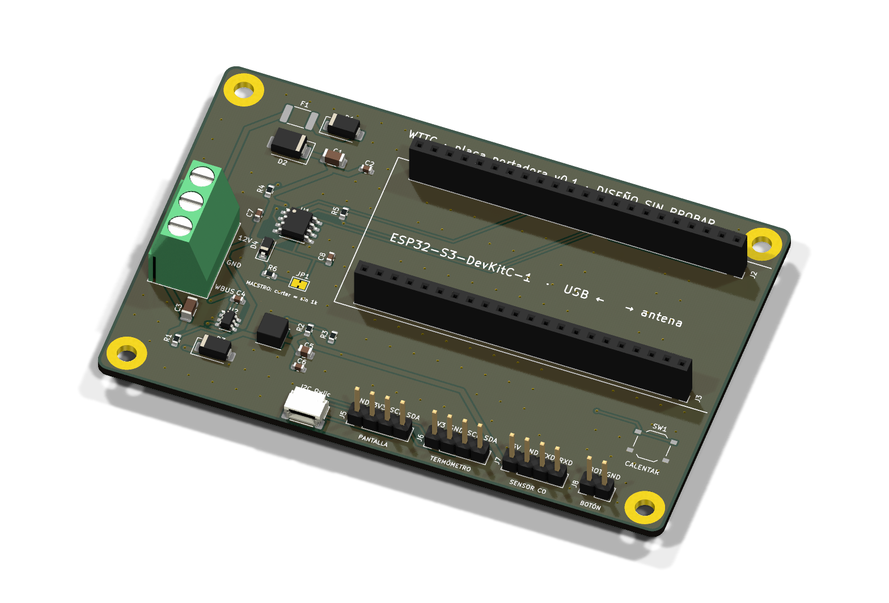

# Placa portadora de WTTC (v0.1)

> **Diseño SIN PROBAR.** Nadie la ha encargado ni montado todavía. La comprobación eléctrica (ERC) y la de reglas de
> diseño (DRC) de KiCad salen limpias, pero eso no garantiza que funcione. Si la encargas, cuéntalo (issue en GitHub):
> la primera que se monte dirá si hay que corregir algo.

Una placa en la que **se pincha la ESP32-S3-DevKitC-1** y que lleva todo lo demás: entrada del vehículo con
protecciones, los 5 V, el transceptor del W-Bus y conectores para las piezas opcionales. Sustituye al montaje con
módulos (placa TJA1020, regulador LM2596 y cables dupont). Diseñada y generada con Claude (Anthropic), desde código:
[`generar/circuito.py`](generar/circuito.py) describe el circuito y `generar.sh` rehace esquema, placa y ficheros.

| Arriba | Abajo |
|---|---|
|  |  |



## Qué lleva

| Bloque | Piezas | Notas |
|---|---|---|
| Entrada del vehículo | Borna de 3 tornillos (J1): **12V · GND · WBUS** | Los tres cables del conector del temporizador. Mídelos con el polímetro: los colores cambian. |
| Protecciones | Fusible rearmable 0,5 A (F1), diodo contra polaridad inversa SS34 (D1), supresor de picos SMBJ24A (D2) | El supresor recorta a menos de 40 V, lo que aguantan el transceptor y el regulador. |
| 5 V | Regulador conmutado **LMR16006X** (U2), 4–60 V, 0,6 A, 28 µA en reposo | El ejemplo de 5 V de la hoja de datos de TI (56 k / 10 k: 5,05 V). Sustituye al LM2596. |
| W-Bus | Transceptor **TJA1021T/20** (U1), mismo patillaje que el TJA1020 de los módulos | RX → IO16, TX ← IO17, SLP fijo a 3V3, como en el montaje con módulo. |
| Resistencia de maestro | 1 kΩ + diodo (R6, D4) y el puente **JP1 «MAESTRO»** | Viene puesto (el temporizador es el maestro del bus). Si alguna vez sobra, se corta la pista fina entre las dos mitades de JP1. |
| ESP32-S3 | Dos zócalos hembra de 22 pines (J2, J3), **filas a 25,4 mm** | La antena queda fuera de la placa, sin cobre debajo. |
| Pantalla | Tira J5: **GND · 3V3 · SCL · SDA** | Orden de las OLED de 0,96" y 1,3". La de 1,5" puede ir en otro orden: mira su serigrafía. |
| Termómetro | Tira J6: **3V3 · GND · SCL · SDA** y conector **Qwiic** (J4) | SHT31 o AHT20. El Qwiic vale para módulos con conector JST-SH (GND, 3V3, SDA, SCL). |
| Sensor de CO | Tira J7: **5V · GND · TXD · RXD** | ZE07-CO: su TXD va al IO15 del ESP32 y su RXD al IO6. |
| Botón «calentar» | Pulsador en la placa (SW1) y tira J8 (**BOT · GND**) para uno externo | IO7 a masa, como en el montaje con módulos. |

Todos los pines son los del firmware (`firmware/WTTC/WTTC.ino`): no hace falta cambiar nada en WTTC.

Placa de 95 × 62 mm, dos caras, 1,6 mm, con planos de masa en las dos caras y cuatro taladros M3 metalizados a
masa. El esquema completo: [wttc-placa-esquema.pdf](fabricacion/wttc-placa-esquema.pdf).

## Encargarla en JLCPCB

Los ficheros están en [`fabricacion/`](fabricacion/). Lo más cómodo: **un paquete por juego**,
[`wttc-placa-encargo-todo.zip`](fabricacion/wttc-placa-encargo-todo.zip) (llega entera) o
[`wttc-placa-encargo-smd.zip`](fabricacion/wttc-placa-encargo-smd.zip) (solo piezas pequeñas). Cada uno trae el
.zip de Gerber, su BOM, su CPL y un LEEME. **Descomprime el paquete**, pero el .zip de Gerber de dentro súbelo tal cual.

1. En [jlcpcb.com](https://jlcpcb.com) → «Order now», sube **`wttc-placa-gerber.zip`**. Lo detecta solo: 2 capas,
   95 × 62 mm. Lo demás, tal cual (1,6 mm, HASL sin plomo si lo prefieres).
2. Activa **«PCB Assembly»**, cara de arriba (**Top side**), y sube la lista de piezas (BOM) y la de posiciones
   (CPL) de **uno de los dos juegos**:

   | Juego | Ficheros | Montaje en JLCPCB | Llega |
   |---|---|---|---|
   | **smd** | `wttc-placa-bom-jlcpcb-smd.csv` y `wttc-placa-cpl-smd.csv` | «Economic» (el barato) | Con las 24 piezas pequeñas. Tú sueldas la borna, los zócalos y las tiras (unos 60 puntos grandes). |
   | **todo** | `wttc-placa-bom-jlcpcb-todo.csv` y `wttc-placa-cpl-todo.csv` | «Standard» (sueldan también las de agujero pasante; algo más caro) | **Entera**: solo hay que pinchar la ESP32-S3. |

   Todas las piezas llevan su código LCSC. Las «extended» cobran unos 3 $ cada una por pedido; el resto son
   «basic». En ningún caso va la ESP32-S3 (se compra aparte y se pincha) ni los módulos opcionales (pantalla,
   termómetro, sensor de CO).
3. **Revisa la vista previa.** Tiene que verse la placa verde con las piezas encima (si solo salen las piezas, no ha
   cogido el Gerber: vuelve a subir `wttc-placa-gerber.zip`). Las posiciones del CPL son el centro de cada pieza y
   ya llevan sumados los giros que JLCPCB suele necesitar (SOIC +270°, SOT-23 +180°, tiras y zócalos +270°).
   **Revisa el giro de las piezas en su vista previa.** KiCad y JLCPCB no siempre coinciden en el ángulo cero: es
   normal tener que girar a mano el regulador (SOT-23-6), el transceptor (SOIC-8) o los diodos en su pantalla, hasta
   que el punto del pin 1 y la raya del cátodo coincidan con la serigrafía.
4. Con el juego «smd», lo de agujero pasante **lo sueldas tú** en un rato: la borna, los dos zócalos de 22 y las tiras
   de pines (en [lista-de-materiales.csv](fabricacion/lista-de-materiales.csv) están todas, con su código LCSC por
   si las compras en LCSC).

Precio orientativo (octubre de 2026, sin comprobar en su web): unos 40–50 $ por cinco placas, dos de ellas montadas
con el juego «smd», más el envío; con «todo» sube algo. Lo que más pesa son las tarifas fijas del montaje, no las
piezas.

## Montaje y primera prueba

1. Con el juego «smd», suelda la borna, los zócalos y las tiras. Los pines de masa van unidos al plano sin «radios»: piden un soldador
   con algo de potencia.
2. **Sin la ESP32 pinchada**, conecta 12 V a la borna y mide: unos **5,0 V** entre 5V y GND de J7, y algo menos de
   12 V (lo que se lleva el diodo de polaridad) en la pata 7 (VBAT) del TJA1021. Si no, desconecta y revisa.
3. Pincha la ESP32-S3 con la antena hacia el borde derecho (el lado de los pines 1, marcado con el cuadrado). **Mide
   antes la distancia entre las filas de tu placa**: tiene que ser 25,4 mm. La de Espressif y las copias habituales
   la tienen así, aunque alguna biblioteca de KiCad diga 22,86.
4. A partir de ahí, como siempre: [instala WTTC](https://wttc.favala.es/instalar.php) y mira en la consola que el
   W-Bus contesta.

**Ojo con el USB:** igual que con el montaje con módulos, no conectes el USB del ordenador con la placa alimentada
por la furgoneta hasta comprobar que la DevKit separa las dos alimentaciones (los diodos «SL» de la placa).

## Limitaciones conocidas (v0.1)

- SLP del TJA1021 va fijo a 3V3, como en el montaje con módulo. Si la ESP32 se alimenta por USB antes de conectar
  los 12 V, el transceptor podría quedarse sin despertar hasta el siguiente arranque. Una v0.2 podría llevarlo a un
  pin del ESP32 (y el firmware, despertarlo).
- Sin resistencias de I2C en la placa: las llevan los módulos de pantalla y termómetro.
- La DevKit va en zócalos (8,5 mm de alto): la placa no cabe en la caja de una DevKit suelta, hace falta una caja
  de al menos 25 mm de alto por dentro.

## Rehacerla

Todo sale de [`generar/circuito.py`](generar/circuito.py) (piezas, valores, códigos LCSC y conexiones) y de la tabla
de posiciones de [`generar/pcb.py`](generar/pcb.py). Para regenerar esquema, placa, comprobaciones y ficheros:

```sh
hardware/placa/generar.sh          # todo (unos 2 minutos)
hardware/placa/generar.sh esquema  # solo el esquema y su comprobación
hardware/placa/generar.sh colocar  # coloca las piezas y comprueba, sin rutar
```

Usa el contenedor oficial de KiCad 9 con Java y [Freerouting](https://github.com/freerouting/freerouting) para el
rutado automático (`generar/Dockerfile`). El esquema, la placa y el proyecto (`wttc-placa.kicad_*`) se abren en
KiCad 9 normal; si se retocan a mano, ojo: `generar.sh` los vuelve a escribir.
